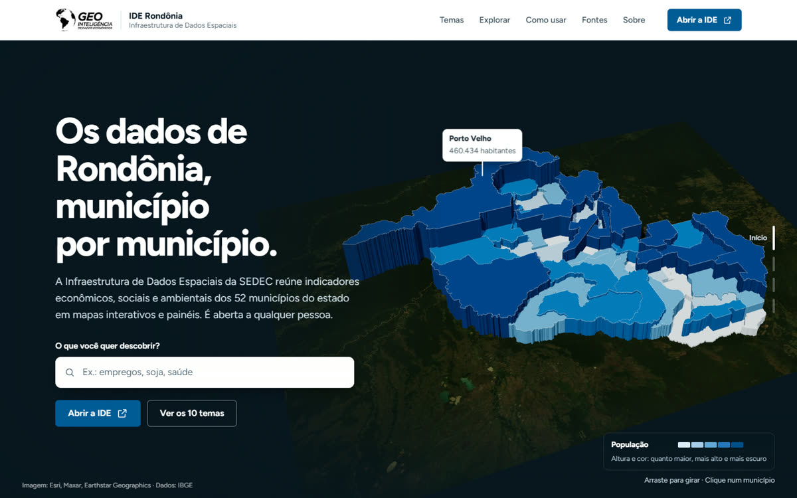
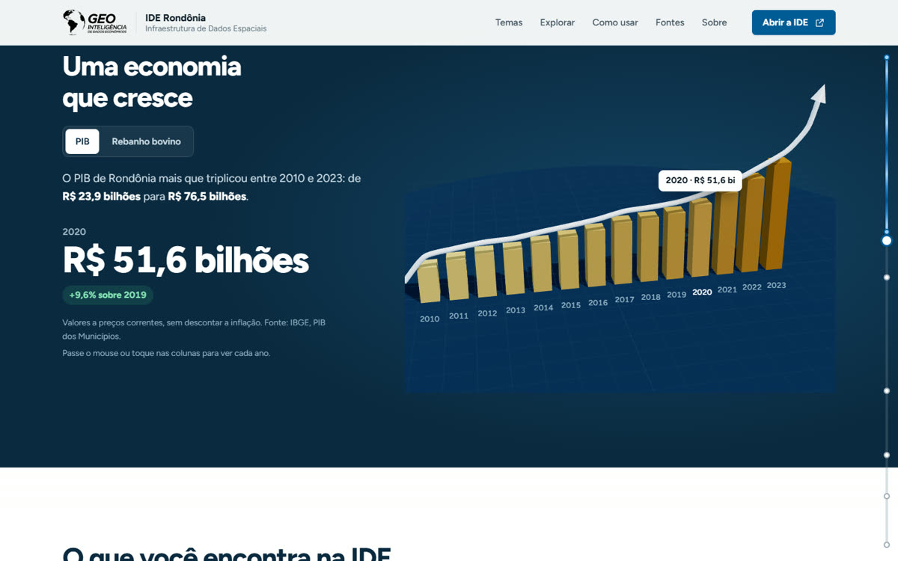
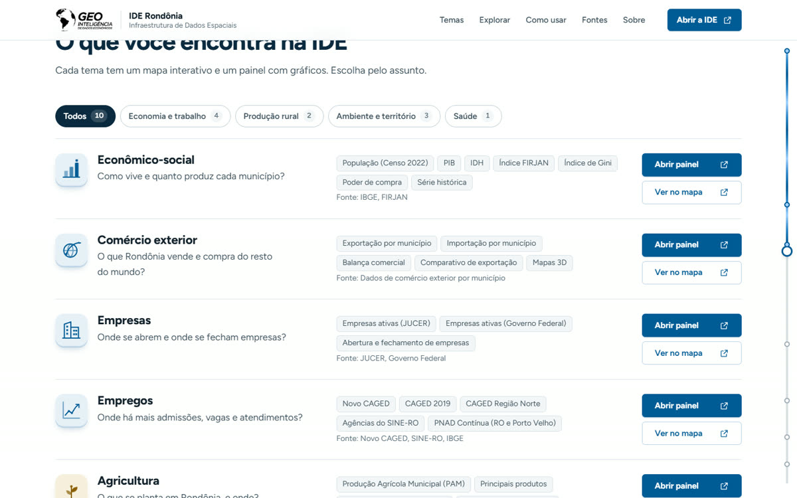
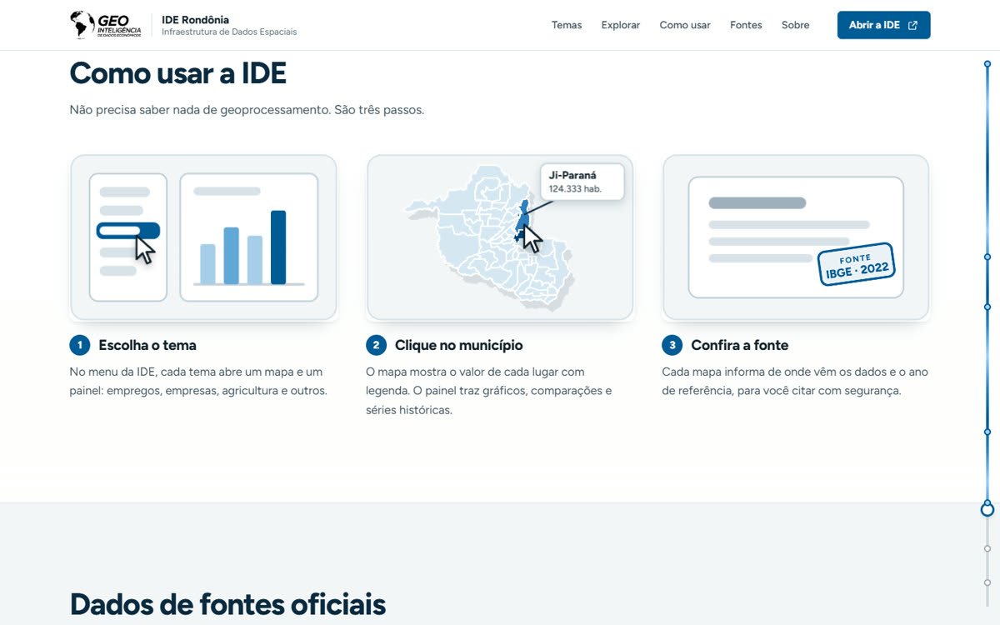
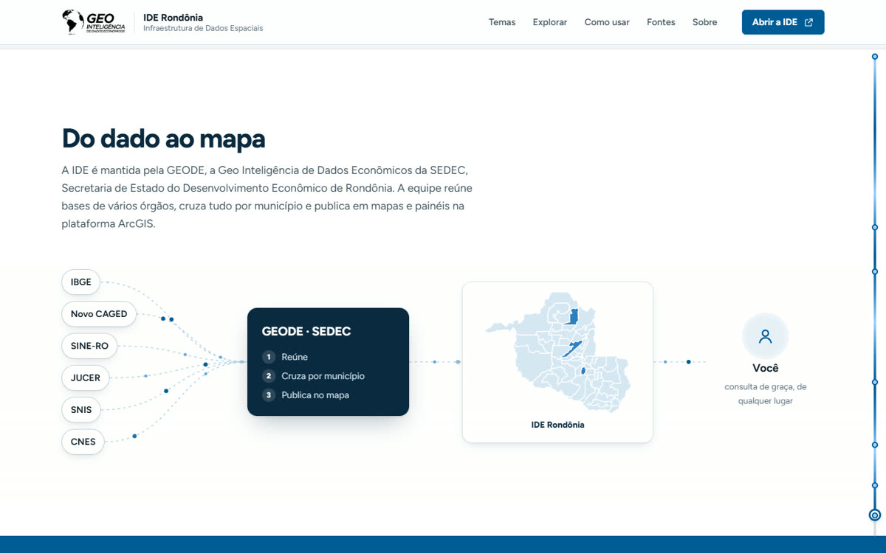
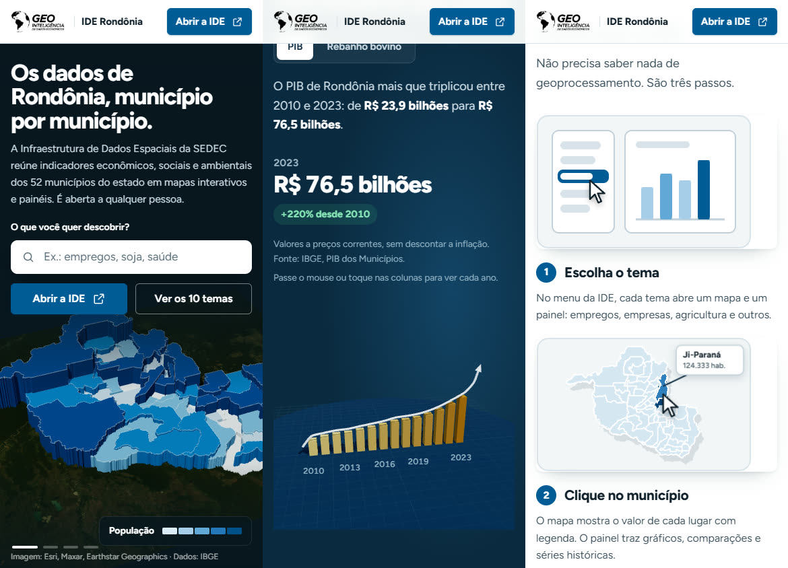

# IDE Rondônia · landing page

Landing page interativa que apresenta a **Infraestrutura de Dados Espaciais (IDE)** da SEDEC-RO,
o portal de mapas e painéis em [geo.sedec.ro.gov.br](https://geo.sedec.ro.gov.br/).

**Ver no ar:** https://prequelunsainted.github.io/ide-rondonia/



> Projeto pessoal de Lucas Gabriel para divulgar a IDE ao público geral. Esta página **não é o site
> oficial**: os mapas, painéis e dados oficiais continuam em geo.sedec.ro.gov.br.

---

## Sumário

- [O que a página faz](#o-que-a-página-faz)
- [Tecnologias](#tecnologias)
- [Estrutura do repositório](#estrutura-do-repositório)
- [Como rodar localmente](#como-rodar-localmente)
- [Como atualizar os dados](#como-atualizar-os-dados)
- [Como refazer o vídeo](#como-refazer-o-vídeo)
- [Acessibilidade e desempenho](#acessibilidade-e-desempenho)
- [Publicação (GitHub Pages)](#publicação-github-pages)
- [Fontes dos dados e créditos](#fontes-dos-dados-e-créditos)
- [Documentação extra](#documentação-extra)

---

## O que a página faz

A IDE reúne indicadores econômicos, sociais e ambientais dos **52 municípios de Rondônia** em
**10 temas**, com **42 painéis** (ArcGIS Dashboards) e **24 mapas interativos**. A landing page explica
isso para quem nunca usou um sistema de mapas e leva a pessoa direto ao painel do tema que procura.

| Seção | O que acontece |
|---|---|
| **Abertura 3D** | Mapa WebGL com os 52 municípios como colunas sobre imagem de satélite real. Zoom de entrada, giro com o mouse, clique abre a ficha do município. Ao rolar, a câmera passa por 3 capítulos: população, PIB (com zoom em Porto Velho) e rebanho bovino. |
| **Busca** | Campo que encontra o tema certo enquanto você digita ("soja", "hospital", "empregos"…). |
| **Uma economia que cresce** | Gráfico 3D com colunas por ano e uma seta 3D que sobe pelo topo delas: PIB de RO 2010–2023 ou rebanho 2010–2025. Hover mostra ano, valor e variação. |
| **Temas** | Os 10 temas com ícones animados, conteúdo de cada painel, fonte e links reais. Filtro com transição animada. |
| **Comece pelo seu município** | Mapa coroplético clicável com ficha: população, densidade, PIB e rebanho, com ranking entre os 52. |
| **Como usar a IDE** | Três passos ilustrados com animação (o passo 2 usa o mapa real e mostra Ji-Paraná). |
| **Dados de fontes oficiais** | Faixa com os nomes das fontes em movimento; passar o mouse explica o que cada uma fornece. |
| **Do dado ao mapa** | Fluxo animado: fontes → GEODE/SEDEC → mapa da IDE → você. |
| **Trilho de rolagem** | Barra animada na margem direita com a seção atual, marcos clicáveis e arrasto. |

| Gráfico 3D | Temas |
|---|---|
|  |  |
| **Como usar** | **Do dado ao mapa** |
|  |  |

No celular:



---

## Tecnologias

- **HTML, CSS e JavaScript puros**, sem build e sem framework. Abre direto no navegador.
- **[three.js](https://threejs.org/) 0.160** (via CDN jsDelivr) para o mapa 3D e o gráfico 3D.
- **[GSAP](https://gsap.com/) 3.12.5** (via cdnjs) com ScrollTrigger (rolagem) e Flip (filtro de temas).
- **[HyperFrames](https://github.com/heygen-com/hyperframes)** para o vídeo em loop usado quando o navegador não tem WebGL.
- **Python 3** (só biblioteca padrão) para baixar e preparar os dados do IBGE.
- Fonte **Figtree** (Google Fonts, licença OFL).

---

## Estrutura do repositório

```
ide-rondonia/
├── site/                     # a página publicada
│   ├── index.html
│   ├── styles.css            # base: cores, tipografia, seções
│   ├── palco.css             # abertura 3D (palco)
│   ├── dinamico.css          # gráfico 3D, trilho, ícones, passos, fontes, fluxo
│   ├── app.js                # busca, catálogo, explorador, trilho, animações de apoio
│   ├── palco3d.js            # mapa 3D da abertura (módulo ES, three.js)
│   ├── grafico3d.js          # gráfico 3D com seta (módulo ES, three.js)
│   ├── icones.js             # 10 ícones SVG animados dos temas
│   └── assets/
│       ├── ro-data.js        # malha dos 52 municípios em SVG + indicadores (gerado)
│       ├── ro-series.js      # séries anuais de PIB e rebanho (gerado)
│       ├── ro-sat.js         # limites da imagem de satélite (gerado)
│       ├── satelite-ro-3d.jpg
│       ├── ide-mapa-loop.mp4 # vídeo de reserva (gerado pelo HyperFrames)
│       ├── ide-mapa-poster.jpg
│       └── geode-logo.png
├── video/                    # projeto HyperFrames do vídeo
├── scripts/                  # scripts Python que geram os dados
├── dados/ibge/               # respostas brutas da API do IBGE usadas no build
└── docs/                     # documentação, decisões de design e capturas
```

---

## Como rodar localmente

Qualquer servidor estático serve. Com Python:

```bash
py -m http.server 8743 --directory site
```

Depois abra http://localhost:8743. (No macOS ou Linux, use `python3` no lugar de `py`.)

> Abrir o `index.html` direto pelo explorador de arquivos não funciona bem: os módulos ES
> (`type="module"`) exigem um servidor.

---

## Como atualizar os dados

Todos os números da página vêm da API pública do IBGE, sem chave. Para atualizar:

```bash
# 1. baixa malha, Censo 2022, PIB, rebanho, área e as séries anuais
py scripts/baixar_ibge.py dados/ibge

# 2. malha dos municípios projetada em SVG + indicadores → site/assets/ro-data.js
py scripts/gerar_ro_data.py dados/ibge site/assets/ro-data.js

# 3. séries anuais do gráfico 3D → site/assets/ro-series.js
py scripts/gerar_series.py dados/ibge site/assets/ro-series.js

# 4. (opcional) nova imagem de satélite alinhada à malha → site/assets/satelite-ro-3d.jpg e ro-sat.js
py scripts/gerar_satelite_3d.py dados/ibge site
```

Os textos fixos que citam números (ex.: "Porto Velho concentra 29%", "+220% desde 2010") estão em
`site/index.html` e `site/grafico3d.js`. Confira-os depois de atualizar.

O conteúdo dos temas (nomes, painéis e links) foi extraído do `config.json` público do app
ArcGIS Experience Builder da IDE. O script `scripts/extrair_conteudo_ide.py` mostra como ler esse arquivo:

```bash
curl -o dados/config-ide.json https://geo.sedec.ro.gov.br/cdn/1/config.json
py scripts/extrair_conteudo_ide.py dados/config-ide.json
```

Mais detalhes em [docs/DADOS.md](docs/DADOS.md).

---

## Como refazer o vídeo

O vídeo `site/assets/ide-mapa-loop.mp4` (12 s, em loop, sem som) aparece no lugar do mapa 3D quando o
navegador não tem WebGL. Ele é feito com HyperFrames (precisa de Node.js e FFmpeg):

```bash
# dados e imagem do vídeo (mapa em Web Mercator 1920x1080)
py scripts/gerar_dados_video.py dados/ibge video/assets
py scripts/gerar_cena_video.py video

cd video
npx hyperframes check
npx hyperframes render -o ide-mapa-loop.mp4
```

Para a versão leve da web:

```bash
ffmpeg -i video/ide-mapa-loop.mp4 -an -vf scale=1280:-2 -c:v libx264 -crf 25 -movflags +faststart site/assets/ide-mapa-loop.mp4
```

---

## Acessibilidade e desempenho

- **Movimento reduzido** (`prefers-reduced-motion`): sem rolagem fixa nem animação de entrada; os capítulos
  aparecem lado a lado e trocam o indicador com um clique; ícones e ilustrações ficam parados no desenho final.
- **Sem WebGL:** o palco mostra o vídeo em loop, com botão de pausa; o gráfico vira colunas em HTML.
- **Teclado:** busca com setas, Enter e Esc; seletores de indicador e de série navegáveis por setas; foco visível.
- **Leitores de tela:** o gráfico 3D tem uma tabela oculta com a série; a lista completa de fontes continua no HTML.
- **Desempenho:** o gráfico 3D só cria o WebGL quando a seção chega perto da tela; os laços de animação
  param quando a seção sai da tela; pixel ratio limitado a 2.
- **Celular:** arrastar o dedo sempre rola a página (o giro do mapa é só com mouse); tocar num município funciona.

Testado com Chrome headless (puppeteer-core) em 1440×900 e 390×844, incluindo hover, arrasto, clique,
troca de série, filtro e movimento reduzido, sem erros de JavaScript.

---

## Publicação (GitHub Pages)

O GitHub Pages serve a branch `gh-pages`, que contém só o conteúdo de `site/`. Para publicar uma
atualização depois de commitar na `main`:

```bash
git subtree split --prefix site -b gh-pages-novo
git push -f origin gh-pages-novo:gh-pages
git branch -D gh-pages-novo
```

---

## Fontes dos dados e créditos

| Dado | Fonte |
|---|---|
| Malha dos 52 municípios | IBGE, API de malhas v3 |
| População residente | IBGE, Censo Demográfico 2022 (SIDRA 4709) |
| PIB a preços correntes | IBGE, PIB dos Municípios 2023 (SIDRA 5938) |
| Rebanho bovino | IBGE, Pesquisa da Pecuária Municipal 2025 (SIDRA 3939) |
| Área territorial | IBGE, 2022 (SIDRA 4714) |
| Temas, painéis e links | IDE da SEDEC-RO (geo.sedec.ro.gov.br) |
| Imagem de satélite | Esri, Maxar, Earthstar Geographics (Esri World Imagery) |

- O PIB está a **preços correntes**: o crescimento mostrado inclui a inflação do período.
- A IDE é mantida pela **GEODE** (Geo Inteligência de Dados Econômicos) da **SEDEC**, Secretaria de Estado do
  Desenvolvimento Econômico de Rondônia. O logo da GEODE pertence ao órgão.
- Bibliotecas: three.js (MIT), GSAP (licença padrão da GreenSock, uso gratuito), fonte Figtree (OFL).

---

## Documentação extra

- [docs/ARQUITETURA.md](docs/ARQUITETURA.md): como os arquivos se conectam e como cada animação funciona.
- [docs/DADOS.md](docs/DADOS.md): de onde vem cada número e como foi processado.
- [docs/DESIGN.md](docs/DESIGN.md): cores, tipografia, componentes e movimento.
- [docs/PRODUCT.md](docs/PRODUCT.md): público, objetivo e princípios da página.

---

Feito por **Lucas Gabriel** · [github.com/Prequelunsainted](https://github.com/Prequelunsainted)
